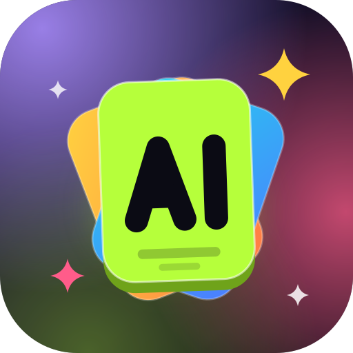
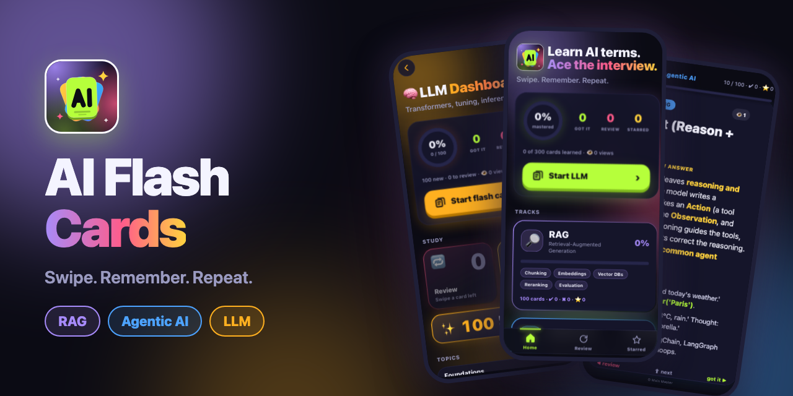

<p align="center">
  
</p>

<h1 align="center">⚡ AI Flash Cards</h1>

<p align="center">
  <b>Learn AI interview terms on your phone. Swipe. Remember. Repeat.</b><br>
  300 cards across RAG, Agentic AI and LLMs, written in simple English with real-life examples.
</p>

<p align="center">
  <a href="https://moin-master.github.io/ai-flash-card/"></a>
</p>
<p align="center">
  <a href="https://github.com/moin-master/ai-flash-card"></a>
</p>

<p align="center">
  
</p>

## 🔗 Links

| | |
|---|---|
| 🌐 **Live app** (open on your phone) | **https://moin-master.github.io/ai-flash-card/** |
| 📦 **Repository** | **https://github.com/moin-master/ai-flash-card** |

> 📲 **Install it like an app:** open the live link on your phone, then use *Share → Add to Home Screen* (iPhone) or *⋮ → Add to Home screen* (Android).

## ✨ Features

- 🃏 **300 interview-ready cards** with a bold-keyword answer and 3 real-life examples each
- 👆 **Swipe to learn:** up = next, right = *got it*, left = *review later*
- ⭐ **Double-tap** a card to star it, double-tap again to unstar
- 👁 **View counter** on every card, and it **resumes where you stopped**
- 📊 **Dashboards** per deck: progress ring, topics, review and starred lists
- 🚀 **Quick-start button** that always opens the deck you used last
- 🎨 **Gen-Z look** with a separate colour theme for each deck
- 🔒 **Private:** progress lives in your browser's storage, nothing is uploaded and there is no login

## 📚 Decks

| Deck | Cards | Theme | What you learn |
|---|:---:|:---:|---|
| 🔎 **RAG** | 100 | 🟣 purple | chunking, embeddings, vector DBs, hybrid search, reranking, evaluation |
| 🕹️ **Agentic AI** | 100 | 🔵 blue | ReAct, tool use, memory, MCP, multi-agent patterns, guardrails |
| 🧠 **LLM** | 100 | 🟠 amber | transformers, attention, fine-tuning, RLHF, quantization, decoding |

Each deck is grouped in a logical learning order (for example Foundations → Architecture → Training → Tuning → Prompting → Inference → Evaluation → Safety).

## 🕹️ How to use

| Gesture | What it does |
|---|---|
| ⬆️ Swipe up / ⬇️ down | next / previous card |
| ✅ Swipe right | I know it |
| 🔁 Swipe left | review it again |
| ⭐ Double tap | star / unstar |

Flow: **Home → deck dashboard → flash cards**, with a **‹** button to go back.

## 🧱 Tech

Plain **HTML, CSS and JavaScript**. No framework, no build step, no server, no dependencies. It runs on GitHub Pages and even by double-clicking `index.html`.

```
ai-flash-card/
├── index.html            # home: progress, tracks, review + starred tabs
├── rag/                  # RAG deck: index.html (dashboard) + rag-flash-card.html
├── agentic/              # Agentic AI deck
├── llm/                  # LLM deck
├── js/                   # app.js (cards), hub.js (home), dashboard.js (dashboards)
├── style/                # style.css (cards + themes), hub.css (home + dashboards)
├── data/                 # decks.js + rag.js / agentic.js / llm.js (the card content)
├── icons/                # PNG home-screen icons
├── docs/                 # study term lists (markdown) and README images
├── icon.svg              # app icon
└── manifest.json         # makes it installable
```

## 🏃 Run it locally

```bash
git clone https://github.com/moin-master/ai-flash-card.git
cd ai-flash-card
python3 -m http.server 8000      # then open http://localhost:8000
```

You can also just open `index.html` in a browser.

## ➕ Add a card

Open the deck's data file (for example `data/rag.js`) and add an object. Wrap words in `**double stars**` to make them bold.

```js
{
  "id": "my-new-term",
  "term": "My New Term",
  "tag": "Topic name",
  "explain": "A short, **interview-ready** definition in 2–3 sentences.",
  "example": [
    "Real-life example one.",
    "Real-life example two.",
    "Real-life example three."
  ]
}
```

## ➕ Add a deck

1. Create `data/<deck>.js` with the cards.
2. Copy a deck folder (for example `llm/`) and change `data-deck`, the titles and the script path.
3. Add an entry to `data/decks.js` with its colour, topics, `page`, `cards` and `script`.
4. Optional: add a colour theme in `style/style.css` (`body[data-theme="..."]`).

## 🚀 Deploy

Push to the `main` branch. **GitHub Pages** (*Settings → Pages → Deploy from a branch → main / root*) serves the site at
`https://moin-master.github.io/ai-flash-card/`.

## 📝 Study notes

The original term lists live in [`docs/`](docs): [RAG](docs/rag-terms.md), [Agentic AI](docs/agentic-ai-terms.md) and [LLM](docs/llm-terms.md). Terms already turned into cards are marked ✅.

---

<p align="center">© Moin Master</p>
